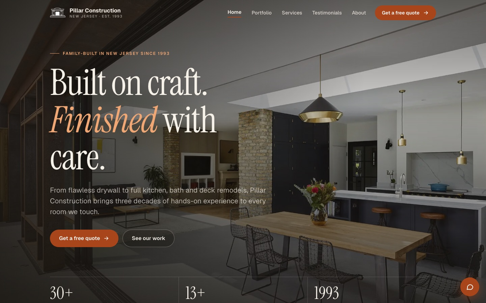
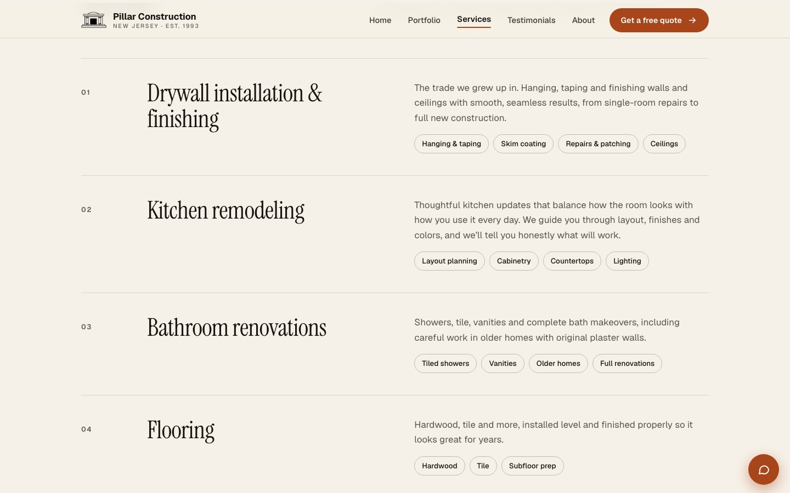
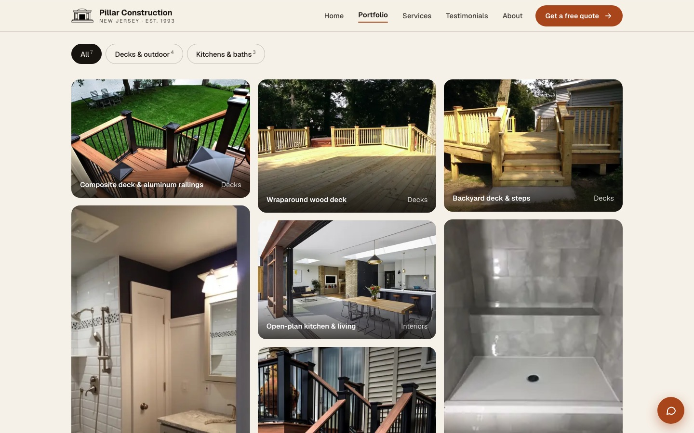
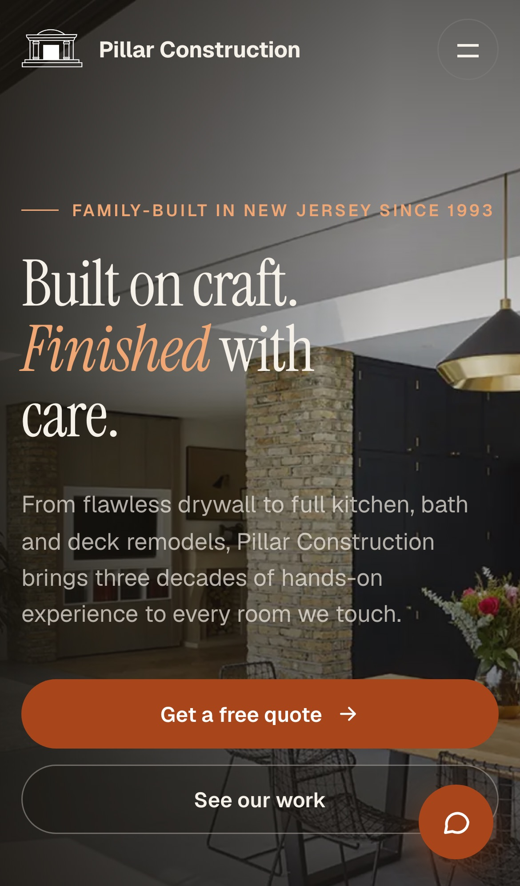

# Pillar Construction

Website for **Pillar Construction**, a family-owned remodeling and drywall contractor in New Jersey (est. 1993).
I first built it in 2023 as a class project and rebuilt it in 2026 as a production-ready static site, with a secure AI assistant, a working contact form, and automated quality checks on every push.




| Services | Portfolio | Mobile |
|---|---|---|
|  |  |  |

## Highlights

- **Secure AI assistant.** The chat widget calls a serverless function (`/api/chat`) that holds the Anthropic API key on the server. The original version asked visitors to paste an API key, which stored it in the browser and sent it from the client.
- **Prompt-injection-safe rendering.** Model replies are inserted as text, never as HTML. Only `[text](page.html)` links to this site's own pages become clickable, so a reply can't inject scripts or off-site links. A browser test feeds the widget a malicious reply to prove it.
- **Abuse limits.** The function validates every request (alternating roles, message count, and per-message and total size caps). It also has an edge rate limit (10 requests per minute per IP), a `max_tokens` cap, and a same-origin check. If Claude declines a request, a server-side fallback model is tried first; if that also declines, the visitor gets a polite reply.
- **Working contact form.** Uses Netlify Forms with a honeypot spam trap, HTML5 validation and a thank-you page.
- **Fast.** Responsive WebP images at 480, 960 and 1600 px with `srcset`/`sizes`, lazy loading below the fold, and a high-priority hero image. Total image weight dropped from about 24 MB of PNGs to 1.2 MB.
- **Accessible.** Skip link, visible focus states, keyboard-operable menu, photo viewer and chat (Escape closes), `aria-expanded`/`aria-current`, reduced-motion support, and WCAG AA colour contrast.
- **Hardened headers.** Content-Security-Policy, `X-Frame-Options`, `nosniff`, a referrer policy and a permissions policy, all set in `netlify.toml`.

## Lighthouse

Measured locally with Lighthouse CI (desktop preset). CI fails the build if a page drops below the budgets in `lighthouserc.json`.

| Page | Performance | Accessibility | Best practices | SEO |
|---|---|---|---|---|
| Home | 100 | 100 | 100 | 100 |
| Portfolio | 99 | 100 | 100 | 100 |
| Contact | 100 | 100 | 100 | 100 |

Lighthouse caught a real problem during development. `backdrop-filter: blur()` on the buttons and image captions, layered over an animated hero photo, caused about 1 s of main-thread blocking. Swapping those for semi-opaque fills took Total Blocking Time to 0 ms with no visible downside. The blur is kept only on the sticky header.

## Testing and CI

Every push and pull request runs [GitHub Actions](.github/workflows/ci.yml):

| Check | Tool | What it covers |
|---|---|---|
| Unit tests | `node:test` | Chat function: request validation, limits, refusal handling, never calling the API on bad input |
| HTML validation | html-validate | Every page against the HTML standard and accessibility rules |
| Link check | linkinator | Crawls the site for broken internal links and assets |
| Browser tests | Playwright (desktop Chrome and Pixel 7) | Each page loads with no console errors or horizontal scroll; mobile menu; portfolio filters and photo viewer; form validation; chat widget security |
| Performance budgets | Lighthouse CI | Fails below 90 performance, 98 accessibility, 95 best practices, 90 SEO |

```bash
npm install
npx playwright install chromium
npm test             # unit + HTML + links + browser tests
npm run lighthouse   # Lighthouse budgets
npm run serve        # preview at http://localhost:4173/home.html
```

## Project structure

```
site/                    Static site that gets published
  *.html                 Home, Portfolio, Services, Testimonials, About, Contact, Thanks, 404
  pillar.css             Design tokens and all styles (no framework)
  site.js                Menu, scroll reveal, portfolio filters and photo viewer
  chatbot.js             Chat widget (talks to /api/chat only)
  img/                   Responsive WebP images
netlify/functions/chat.mjs   Serverless endpoint: auth, rate limit, error mapping
lib/chat-core.mjs            Validation and Claude call, kept separate so it can be unit-tested
tests/unit/                  Node test runner
tests/e2e/                   Playwright
scripts/screenshots.mjs      Regenerates the README screenshots
```

## Deploying

The site is set up for [Netlify](https://www.netlify.com/) (free tier):

1. Import this repository in Netlify. `netlify.toml` already sets the publish folder (`site`) and functions folder.
2. In **Site configuration → Environment variables**, add `ANTHROPIC_API_KEY`. Optionally set `CLAUDE_MODEL` to override the default model (`claude-opus-5-5`), for example a cheaper Haiku model.
3. Deploy. Form submissions appear under **Forms** in the Netlify dashboard. Turn on email notifications there.

Without the API key, the site still works and the chat widget shows a friendly "not configured" message.

## Tech

HTML, CSS and vanilla JavaScript with no front-end framework or build step. Netlify Functions (Node 20+) with the official Anthropic SDK. Playwright, html-validate, linkinator, Lighthouse CI and GitHub Actions.

---

Built by Chris Bevacqua.
